# Student Course Registration and Management System
## Academic Mini Project Report & Submission Guide

> **Degree:** Bachelor of Technology (B.Tech) in Computer Science and Engineering  
> **Course:** Object-Oriented Programming (OOP) / Java Programming Mini Project  
> **Academic Year:** `[202X - 202X]`  
> **Implementation Language:** Java (Standard Edition 17+)  
> **GUI Framework:** Java Swing (`javax.swing` & `java.awt`)  
> **Persistence Mechanism:** Flat-File CSV (`java.io` with `BufferedReader` / `BufferedWriter`)  
> **External Dependencies:** None (100% Java SE Standard Library)

---

## Guide Overview

This document provides a complete, structured blueprint for preparing your official college mini project report for the **Student Course Registration and Management System**.

All technical sections, class diagrams, method signatures, file formats, and test tables are derived directly from the verified Java source code in `src/com/college/sms/`. Placeholders marked with `[Square Brackets]` (e.g., student name, roll number, college name, guide name) should be filled in with your institution's specific details.

---

## 1. Cover Page and Certificate Template

### 1.1 Cover Page Layout

```text
=================================================================================
             [INSTITUTION / UNIVERSITY NAME]
       [DEPARTMENT OF COMPUTER SCIENCE AND ENGINEERING]

                     [COLLEGE LOGO HERE]

               A MINI PROJECT REPORT ON
    "STUDENT COURSE REGISTRATION AND MANAGEMENT SYSTEM"

   Submitted in partial fulfillment of the requirements for the award
                         of the degree of
                      BACHELOR OF TECHNOLOGY
                                IN
                 COMPUTER SCIENCE AND ENGINEERING

Submitted by:
   1. [Student Full Name 1]       (Roll No. / USN: [Roll Number 1])
   2. [Student Full Name 2]       (Roll No. / USN: [Roll Number 2])  -- [Optional]

Under the Esteemed Guidance of:
   [Internal Guide Name]
   [Designation / Assistant Professor]
   Department of Computer Science and Engineering

                        ACADEMIC YEAR: [202X - 202X]
=================================================================================
```

---

### 1.2 Certificate of Originality Template

```text
               [INSTITUTION / COLLEGE NAME]
        DEPARTMENT OF COMPUTER SCIENCE AND ENGINEERING

                          CERTIFICATE

This is to certify that the mini project titled "STUDENT COURSE REGISTRATION 
AND MANAGEMENT SYSTEM" is a bona fide record of independent work carried out by:

   • [Student Name 1]      -  [Roll Number / USN 1]
   • [Student Name 2]      -  [Roll Number / USN 2]

students of [Second / Third] Year B.Tech, Department of Computer Science and 
Engineering, in partial fulfillment of the academic curriculum prescribed by 
[University Name] during the academic year [202X - 202X].

The project has been reviewed and verified for originality and adherence to the 
prescribed curriculum standards.


_______________________             _______________________
[Internal Guide Name]               [Head of the Department]
Project Guide, Dept of CSE          HOD, Dept of CSE
[College Name]                      [College Name]


Internal Examiner: _______________________      Date: ______________

External Examiner: _______________________      Date: ______________
```

---

## 2. Acknowledgement

```text
ACKNOWLEDGEMENT

I/We express my/our deepest gratitude to our respected Principal, [Principal Name], 
and our Head of the Department, [HOD Name], Department of Computer Science and 
Engineering, for providing the necessary institutional facilities, academic 
environment, and encouragement to undertake this project.

I/We convey our profound gratitude and indebtedness to our Project Guide, 
[Guide Name], [Designation], Department of CSE, for their constant guidance, valuable 
suggestions, critical insights, and continuous encouragement throughout the 
development and documentation of the Student Course Registration and Management System.

I/We would also like to thank all the teaching and non-teaching faculty members of 
the Department of Computer Science and Engineering for their direct and indirect 
support during the course of this semester.

Lastly, I/we thank our parents and fellow classmates for their unwavering support, 
motivation, and constructive feedback during the project lifecycle.


[Student Name 1] ([Roll No. 1])
[Student Name 2] ([Roll No. 2])
Department of Computer Science and Engineering
[College / Institution Name]
```

---

## 3. Abstract

The **Student Course Registration and Management System** is a modular, desktop-based academic application engineered in Java using Java Swing for the graphical interface and flat-file Comma-Separated Values (CSV) persistence for local data storage.

Traditional academic enrollment processes in colleges often rely on manual paperwork or disconnected spreadsheets, leading to seat capacity overruns, duplicate course registrations by the same student, and orphaned records caused by untimely record deletions. This project addresses these challenges by implementing a five-tier software architecture comprising:
1. **Domain Models**: Encapsulated entities (`Student`, `Course`, `Registration`) validating all attributes.
2. **Custom Exceptions**: A domain-specific checked exception hierarchy (`SMSException` and its subclasses) preventing crashes.
3. **Storage Engine**: `FileStorage` using buffered I/O streams (`BufferedReader`, `BufferedWriter`, `FileReader`, `FileWriter`) with quote-aware CSV tokenization.
4. **Service Layer**: Business-logic controllers enforcing referential integrity, seat capacity checks, and uniqueness constraints across in-memory collections (`ArrayList`).
5. **Graphical User Interface**: A modern, interactive Swing interface (`LoginFrame`, `MainFrame`, `DashboardPanel`, `StudentPanel`, `CoursePanel`, `RegistrationPanel`, `ViewRegistrationsPanel`) that synchronizes views dynamically using the `RefreshablePanel` interface.

The application requires no external database drivers or third-party libraries, relying strictly on standard Java SE. The system was verified across 25 automated test cases, ensuring that all entity mutations persist across JVM restarts without data corruption.

---

## 4. Introduction and Problem Definition

### 4.1 Project Overview
In higher education institutions, student course allocation is a fundamental administrative workflow. Every academic term, students register for core and elective subjects offered across departments. Academic offices must ensure that:
- Course maximum capacities are strictly honored.
- Students are not enrolled in the same course more than once.
- Student and course records cannot be deleted if active registrations depend on them.
- Registration records survive system shutdowns without requiring a dedicated SQL database server.

The **Student Course Registration and Management System** addresses these needs by combining object-oriented programming principles with a graphical user interface and flat-file persistence.

### 4.2 Brief Description
The application is executed via a single launcher class (`com.college.sms.Main`). Upon startup, it validates and initializes storage files in the `data/` directory:
- `students.csv`: Contains student identities, contact information, and academic department details.
- `courses.csv`: Maintains the subject catalog, instructor allocations, and seat quotas.
- `registrations.csv`: Tracks historical and active enrollments connecting students with courses.

Administrative users log in via a secured authentication portal (`admin` / `admin123`) to access a tabbed dashboard. The dashboard provides real-time statistics (total students, total courses, active enrollments), a full student CRUD interface with search filters, an interactive course catalog showing live remaining seat counters, an enrollment panel with dropdown selectors, and an enrollment registry with cancellation and course-dropping capabilities.

### 4.3 Existing System and Limitations
1. **Paper-Based Manual Forms**: High administrative overhead, slow processing times, and potential for manual data entry errors.
2. **Disconnected Spreadsheets**: Excel files lack real-time validation constraints; two administrators can easily overbook a course beyond its physical classroom capacity.
3. **No Referential Integrity**: In spreadsheets, deleting a student row does not automatically alert or update the course enrollment list, leading to invalid enrollment records.
4. **Duplicate Enrollment Hazards**: Without programmatic constraints, students frequently submit duplicate registrations for the same subject across multiple sections.

### 4.4 Proposed System and Problem Definition
The proposed software provides an automated, self-contained desktop system that:
- Centralizes student, course, and enrollment management.
- Automates seat capacity tracking (`Remaining Seats = Max Capacity - Active Enrollments`).
- Rejects duplicate student IDs, duplicate course codes, and duplicate registrations.
- Protects referential integrity by preventing student or course deletion while active enrollments exist.
- Saves all state changes to readable CSV files automatically upon every successful operation.

---

## 5. Objectives

1. **Object-Oriented Design**: Implement a clean multi-layer Java architecture adhering to encapsulation, constructor overloading, abstraction, association, aggregation, and polymorphism.
2. **Robust Validation**: Enforce input checks on all user inputs (valid email formats, bounded semesters $1 \le s \le 12$, positive credits $1 \le c \le 10$, non-empty IDs without spaces/commas).
3. **Capacity & Duplicate Guarding**: Ensure that course registrations are blocked when capacity reaches zero (`CourseFullException`) or when a duplicate enrollment is attempted (`DuplicateResourceException`).
4. **Referential Integrity**: Guarantee that deleting a student or course is prevented if active course registrations exist, preventing data anomalies.
5. **Flat-File CSV Persistence**: Design a safe serialization engine using `BufferedReader`, `BufferedWriter`, `FileReader`, and `FileWriter` with `try-with-resources` to preserve data across application sessions.
6. **Graphical User Interface**: Create a user-friendly Java Swing desktop interface featuring tabbed navigation, live search filters, sortable tables (`JTable`), dropdowns (`JComboBox`), and feedback dialogs (`JOptionPane`).

---

## 6. Software Requirements Specification (SRS)

### 6.1 Hardware Requirements
- **Processor:** Dual-core x86-64 / ARM processor (1.8 GHz or faster)
- **RAM:** Minimum 2 GB (4 GB recommended)
- **Hard Disk Space:** Minimum 100 MB free space (including JVM installation)
- **Display:** $1280 \times 720$ resolution or higher

### 6.2 Software Requirements
- **Operating System:** Windows 10/11, Ubuntu Linux 20.04+, or macOS 12+
- **Platform:** Java SE Development Kit (JDK 17 LTS or higher; tested and verified on JDK 25)
- **Compiler / Tools:** `javac` (compiler), `java` (launcher)
- **Recommended IDE:** Antigravity IDE, Visual Studio Code, IntelliJ IDEA, or Eclipse

### 6.3 Functional Requirements
- **FR-1 Authentication:** The system shall authenticate administrator credentials (`admin` / `admin123`) before displaying the main dashboard.
- **FR-2 Dashboard Metrics:** The system shall calculate and display live summary counters for Total Students, Total Courses, and Active Registrations, alongside the 10 most recent registrations.
- **FR-3 Student Management:** The system shall allow administrators to add, update, delete, search, and list students. Clicking a student in the table shall populate the form for updating.
- **FR-4 Course Management:** The system shall allow adding, updating, deleting, searching, and viewing courses with dynamically calculated available seat counts.
- **FR-5 Course Registration:** The system shall allow selecting a student and course via `JComboBox`, previewing their details live, and registering the student if seats are available.
- **FR-6 Registration Dropping / Cancellation:** The system shall allow administrators to view all registrations, filter by status (`ALL`, `ACTIVE`, `CANCELLED`), and cancel an active registration, which releases the seat back to the catalog.
- **FR-7 Data Persistence:** The system shall save student, course, and registration records to `data/students.csv`, `data/courses.csv`, and `data/registrations.csv` upon every mutation, and restore them upon application startup.
- **FR-8 Referential Integrity Protection:** The system shall refuse deletion of any student or course that is currently associated with active registrations.

### 6.4 Non-Functional Requirements
- **NFR-1 Usability:** Clear input labels, table selection listeners, and informative `JOptionPane` dialogs for every success and error event.
- **NFR-2 Reliability:** Corrupt or malformed lines in CSV files shall be logged and skipped; the application must never crash due to corrupted individual rows.
- **NFR-3 Maintainability:** High cohesion and loose coupling through separate packages (`model`, `service`, `storage`, `gui`, `exception`).
- **NFR-4 Portability:** Uses pure Java standard libraries with platform-independent file separators, running seamlessly on Windows, macOS, and Linux.

---

## 7. Class Diagram & Architecture

### 7.1 Architecture Layers

```text
┌────────────────────────────────────────────────────────┐
│                      GUI LAYER                         │
│   (LoginFrame, MainFrame, DashboardPanel,              │
│    StudentPanel, CoursePanel, RegistrationPanel,       │
│    ViewRegistrationsPanel, UITheme, RefreshablePanel)  │
└──────────────────────────┬─────────────────────────────┘
                           │ (Calls Service Methods)
┌──────────────────────────▼─────────────────────────────┐
│                    SERVICE LAYER                       │
│    (StudentService, CourseService, RegistrationService)│
│    Enforces: Capacity Limits, Referential Integrity,   │
│              Uniqueness, Keyword Search Filters        │
└────────────┬─────────────────────────────┬─────────────┘
             │ (Validates Model Entities)  │ (Persists State)
┌────────────▼─────────────┐ ┌─────────────▼─────────────┐
│       MODEL LAYER        │ │       STORAGE LAYER       │
│  (Student, Course,       │ │  (FileStorage)            │
│   Registration)          │ │  Reads/Writes CSV files   │
└──────────────────────────┘ └─────────────┬─────────────┘
                                           │ (File I/O)
                             ┌─────────────▼─────────────┐
                             │    PHYSICAL STORAGE       │
                             │  data/students.csv        │
                             │  data/courses.csv         │
                             │  data/registrations.csv   │
                             └───────────────────────────┘
```

---

### 7.2 Mermaid Class Diagram

```mermaid
classDiagram
    direction TB

    class Student {
        -String studentId
        -String name
        -String email
        -String department
        -int semester
        -String phone
        +Student()
        +Student(String, String, String, String, int, String)
        +getStudentId() String
        +setStudentId(String) void
        +getName() String
        +setName(String) void
        +getEmail() String
        +setEmail(String) void
        +getDepartment() String
        +setDepartment(String) void
        +getSemester() int
        +setSemester(int) void
        +getPhone() String
        +setPhone(String) void
        +getDisplayDetails() String
        +toString() String
        +equals(Object) boolean
        +hashCode() int
    }

    class Course {
        -String courseCode
        -String courseTitle
        -int credits
        -String instructor
        -int maxCapacity
        +Course()
        +Course(String, String, int, String, int)
        +getCourseCode() String
        +setCourseCode(String) void
        +getCourseTitle() String
        +setCourseTitle(String) void
        +getCredits() int
        +setCredits(int) void
        +getInstructor() String
        +setInstructor(String) void
        +getMaxCapacity() int
        +setMaxCapacity(int) void
        +getDisplayDetails() String
        +toString() String
        +equals(Object) boolean
        +hashCode() int
    }

    class Registration {
        +STATUS_ACTIVE: String$
        +STATUS_CANCELLED: String$
        -String registrationId
        -Student student
        -Course course
        -String registrationDate
        -String status
        +Registration()
        +Registration(String, Student, Course, String)
        +Registration(String, Student, Course, String, String)
        +getRegistrationId() String
        +getStudent() Student
        +getCourse() Course
        +getStudentId() String
        +getCourseCode() String
        +getRegistrationDate() String
        +getStatus() String
        +isActive() boolean
        +cancel() void
        +isDuplicateOf(String, String) boolean
        +getDisplayDetails() String
        +toString() String
        +equals(Object) boolean
        +hashCode() int
    }

    class SMSException {
        +SMSException(String)
        +SMSException(String, Throwable)
    }

    class ValidationException {
        +ValidationException(String)
    }

    class DuplicateResourceException {
        +DuplicateResourceException(String)
    }

    class ResourceNotFoundException {
        +ResourceNotFoundException(String)
    }

    class CourseFullException {
        +CourseFullException(String)
    }

    SMSException <|-- ValidationException
    SMSException <|-- DuplicateResourceException
    SMSException <|-- ResourceNotFoundException
    SMSException <|-- CourseFullException

    Registration --> Student : Association (HAS-A)
    Registration --> Course : Association (HAS-A)

    class FileStorage {
        -File dataDir
        -File studentsFile
        -File coursesFile
        -File registrationsFile
        +initStorage() void
        +hasExistingData() boolean
        +saveStudents(List~Student~) void
        +loadStudents() List~Student~
        +saveCourses(List~Course~) void
        +loadCourses() List~Course~
        +saveRegistrations(List~Registration~) void
        +loadRegistrations(StudentService, CourseService) List~Registration~
        -escapeCsv(String) String
        -parseCsvLine(String) List~String~
    }

    class StudentService {
        -List~Student~ students
        -RegistrationService registrationService
        -FileStorage fileStorage
        +addStudent(Student) void
        +updateStudent(Student) void
        +deleteStudent(String) void
        +findStudentById(String) Student
        +getStudentById(String) Student
        +searchStudents(String) List~Student~
        +getAllStudents() List~Student~
        +getStudentCount() int
        +loadInitialData(List~Student~) void
        -validateStudentData(Student) void
        -saveToFile() void
    }

    class CourseService {
        -List~Course~ courses
        -RegistrationService registrationService
        -FileStorage fileStorage
        +addCourse(Course) void
        +updateCourse(Course) void
        +deleteCourse(String) void
        +findCourseByCode(String) Course
        +getCourseByCode(String) Course
        +searchCourses(String) List~Course~
        +getAllCourses() List~Course~
        +getCourseCount() int
        +getAvailableSeats(String) int
        +loadInitialData(List~Course~) void
        -validateCourseData(Course) void
        -saveToFile() void
    }

    class RegistrationService {
        -List~Registration~ registrations
        -StudentService studentService
        -CourseService courseService
        -FileStorage fileStorage
        -int idCounter
        +registerStudent(String, String) Registration
        +registerStudent(String, String, String) Registration
        +registerStudent(String, String, String, String) Registration
        +cancelRegistration(String) void
        +cancelRegistration(String, String) void
        +findRegistrationById(String) Registration
        +getRegistrationById(String) Registration
        +isAlreadyRegistered(String, String) boolean
        +hasActiveRegistrationsForStudent(String) boolean
        +hasActiveRegistrationsForCourse(String) boolean
        +getActiveRegistrationCountForCourse(String) int
        +getAllRegistrations() List~Registration~
        +getActiveRegistrations() List~Registration~
        +loadInitialData(List~Registration~) void
        -generateRegistrationId() String
        -saveToFile() void
    }

    StudentService o-- Student : Aggregation (List)
    CourseService o-- Course : Aggregation (List)
    RegistrationService o-- Registration : Aggregation (List)

    RegistrationService ..> StudentService : Uses
    RegistrationService ..> CourseService : Uses
    StudentService ..> RegistrationService : Queries registrations
    CourseService ..> RegistrationService : Queries registrations

    StudentService --> FileStorage : Calls saveStudents()
    CourseService --> FileStorage : Calls saveCourses()
    RegistrationService --> FileStorage : Calls saveRegistrations()

    class RefreshablePanel {
        <<interface>>
        +refreshData()* void
    }

    RefreshablePanel <|.. DashboardPanel : Implements
    RefreshablePanel <|.. StudentPanel : Implements
    RefreshablePanel <|.. CoursePanel : Implements
    RefreshablePanel <|.. RegistrationPanel : Implements
    RefreshablePanel <|.. ViewRegistrationsPanel : Implements
```



---

## 8. Implementation Details

### 8.1 Inventory of Project Classes

| Class Name | Package | Primary Responsibility |
|---|---|---|
| `Main` | `com.college.sms` | Entry point; configures Look-and-Feel, wires services and storage, loads files, launches `LoginFrame`. |
| `Student` | `com.college.sms.model` | Entity encapsulating student attributes (`studentId`, `name`, `email`, `department`, `semester`, `phone`). |
| `Course` | `com.college.sms.model` | Entity encapsulating course attributes (`courseCode`, `courseTitle`, `credits`, `instructor`, `maxCapacity`). |
| `Registration` | `com.college.sms.model` | Association entity linking one `Student` and one `Course`, registration date, and status (`ACTIVE`/`CANCELLED`). |
| `SMSException` | `com.college.sms.exception` | Base checked exception for all business and validation errors in the system. |
| `ValidationException` | `com.college.sms.exception` | Thrown on invalid format, spaces/commas in IDs, or out-of-range numerical fields. |
| `DuplicateResourceException` | `com.college.sms.exception` | Thrown on duplicate Student ID, Course Code, or duplicate active student-course registration. |
| `ResourceNotFoundException` | `com.college.sms.exception` | Thrown when searching for a nonexistent student, course, or registration ID. |
| `CourseFullException` | `com.college.sms.exception` | Thrown when attempting to enroll in a course whose active registrations equal its seating capacity. |
| `FileStorage` | `com.college.sms.storage` | Handles buffered reading and writing to `students.csv`, `courses.csv`, and `registrations.csv`. |
| `StudentService` | `com.college.sms.service` | Manages `ArrayList<Student>`, validation, keyword search, CRUD operations, and referential integrity. |
| `CourseService` | `com.college.sms.service` | Manages `ArrayList<Course>`, validation, course search, available seat calculations, and CRUD operations. |
| `RegistrationService` | `com.college.sms.service` | Coordinates enrollments, drops, duplicate checks, sequential ID generation, and active seat queries. |
| `UITheme` | `com.college.sms.gui` | Centralizes fonts (`Segoe UI`), color palette, button factories, and table cell renderers. |
| `RefreshablePanel` | `com.college.sms.gui` | Interface implemented by all tabs to support synchronized data reloads. |
| `LoginFrame` | `com.college.sms.gui` | Login window authenticating the administrator before launching the main window. |
| `MainFrame` | `com.college.sms.gui` | Primary window hosting header banner, user status, logout, and `JTabbedPane` containing the 5 panels. |
| `DashboardPanel` | `com.college.sms.gui` | Overview tab showing 3 live stat cards, quick navigation buttons, and recent registrations table. |
| `StudentPanel` | `com.college.sms.gui` | Student management panel with entry form, action buttons, search bar, and interactive `JTable`. |
| `CoursePanel` | `com.college.sms.gui` | Course catalog panel with entry form, action buttons, search bar, and available seats table. |
| `RegistrationPanel` | `com.college.sms.gui` | Course enrollment panel with student and course `JComboBox` selectors and real-time detail preview cards. |
| `ViewRegistrationsPanel` | `com.college.sms.gui` | Enrollment registry with status filter (`ALL`/`ACTIVE`/`CANCELLED`), search bar, and course cancellation button. |

---

### 8.2 Object-Oriented Concepts Demonstrated

#### 1. Encapsulation & Data Hiding
All fields in domain models are marked `private`. External classes must invoke public getters and setters. Mutators validate incoming parameters, ensuring that the internal object state is always valid:
```java
public void setSemester(int semester) {
    if (semester < 1 || semester > 12) {
        throw new IllegalArgumentException("Semester must be between 1 and 12.");
    }
    this.semester = semester;
}
```

#### 2. Constructor Overloading & Chaining
Constructors are overloaded to permit both empty initialization and complete parameterized instantiation. `Registration` chains constructors via `this(...)` to supply default status `ACTIVE`:
```java
public Registration(String registrationId, Student student, Course course, String registrationDate) {
    this(registrationId, student, course, registrationDate, STATUS_ACTIVE);
}
```

#### 3. Association (`HAS-A` Relationship)
`Registration` demonstrates an association relationship by holding direct references to `Student` and `Course` objects:
```java
public class Registration {
    private Student student;
    private Course course;
    // ...
}
```

#### 4. Aggregation
`StudentService`, `CourseService`, and `RegistrationService` aggregate collections of entities inside generic `ArrayList` instances without tight coupling:
```java
public class StudentService {
    private final List<Student> students = new ArrayList<>();
    // ...
}
```

#### 5. Inheritance & Custom Exceptions
Custom checked exceptions extend `SMSException`, which in turn extends `java.lang.Exception`:
```java
public class SMSException extends Exception { ... }
public class CourseFullException extends SMSException { ... }
public class DuplicateResourceException extends SMSException { ... }
```

#### 6. Polymorphism & Interface Realization
All five GUI panels implement the `RefreshablePanel` interface. `MainFrame` holds a `List<RefreshablePanel>` and calls `refreshData()` polymorphically across all panels:
```java
public void refreshAllPanels() {
    for (RefreshablePanel panel : registeredPanels) {
        panel.refreshData();
    }
}
```

#### 7. Method Overriding
Every model overrides `equals()` and `hashCode()` based on business primary keys (`studentId`, `courseCode`, `registrationId`), ensuring accurate identity checks in Java collections.

---

### 8.3 File Handling & CSV Persistence Architecture

#### I/O Stream Choice
- `BufferedReader` + `FileReader`: Reads files line-by-line efficiently without loading entire raw character buffers manually into memory.
- `BufferedWriter` + `FileWriter`: Buffers writes and calls `newLine()` to ensure platform-independent newline characters (`\r\n` on Windows, `\n` on Linux).
- Automatic resource cleanup via `try-with-resources`:
```java
try (BufferedReader reader = new BufferedReader(new FileReader(studentsFile))) {
    String line = reader.readLine(); // skip header
    while ((line = reader.readLine()) != null) {
        // Parse and process
    }
} catch (IOException e) {
    System.err.println("Error reading " + studentsFile.getName() + ": " + e.getMessage());
}
```

#### Delimiter & Quote Handling
Course titles often include commas (e.g., `"Data Structures & Algorithms"`). `FileStorage` implements standard RFC-4180 escaping:
- **Writing (`escapeCsv`)**: Wraps fields containing commas or quotes in double quotes, escaping embedded quotes as `""`.
- **Reading (`parseCsvLine`)**: Scans character-by-character, toggling an `inQuotes` flag so commas inside quotes are not treated as field separators.

#### Real-time State Synchronization
Every mutating operation in `StudentService`, `CourseService`, and `RegistrationService` calls `saveToFile()` immediately upon success, preventing data loss if the application is closed unexpectedly.

---

### 8.4 Exception Handling Strategy

1. **Checked Exceptions for Business Rules**:
   - Compels calling methods in GUI and Service layers to handle recoverable business conditions explicitly (`try-catch`).
2. **User-Friendly Error Dialogs**:
   - GUI button handlers catch exceptions and display clear feedback using `JOptionPane.showMessageDialog(this, ex.getMessage(), "Title", JOptionPane.ERROR_MESSAGE)`.
3. **No Silent Error Swallowing**:
   - Zero empty `catch` blocks. Unparseable numbers in CSV rows log explicit warnings and skip corrupted rows without terminating the application.
4. **Referential Integrity Defense**:
   - Prevents student/course deletion when active registrations reference them, throwing `ValidationException` with an explanation.

---

## 9. Results and Test Verification

### 9.1 Verification Test Table (All 25 Verified Cases)

The following 25 test cases were executed programmatically against the source code via `VerifyAll25Cases.java`:

| Test ID | Test Category | Action / Input Tested | Expected Result | Actual Verified Result | Status |
|---|---|---|---|---|---|
| **TC-01** | Validation | Empty Student ID (`""`) | Rejection with `IllegalArgumentException` | Caught `IllegalArgumentException`: "Student ID cannot be empty." | **PASS** |
| **TC-02** | Validation | Empty Student Name (`"   "`) | Rejection with `IllegalArgumentException` | Caught `IllegalArgumentException`: "Student name cannot be empty." | **PASS** |
| **TC-03** | Validation | Invalid Email (`"studentcollege"`) | Rejection with `ValidationException` | Caught `ValidationException`: "A valid email address containing '@' and '.' is required." | **PASS** |
| **TC-04** | Validation | Short Phone (`"123"`) | Rejection with `ValidationException` | Caught `ValidationException`: "Phone number must contain between 7 and 15 digits/symbols..." | **PASS** |
| **TC-05** | Validation | Empty Course Code (`""`) | Rejection with `IllegalArgumentException` | Caught `IllegalArgumentException`: "Course code cannot be empty." | **PASS** |
| **TC-06** | Validation | Empty Course Title (`""`) | Rejection with `IllegalArgumentException` | Caught `IllegalArgumentException`: "Course title cannot be empty." | **PASS** |
| **TC-07** | Validation | Student ID with spaces (`"S 101"`) | Rejection with `ValidationException` | Caught `ValidationException`: "Student ID cannot contain spaces or commas." | **PASS** |
| **TC-08** | Validation | Course Code with comma (`"CS,101"`) | Rejection with `ValidationException` | Caught `ValidationException`: "Course code cannot contain spaces or commas." | **PASS** |
| **TC-09** | Validation | Semester out of bounds (`13`) | Rejection with `IllegalArgumentException` | Caught `IllegalArgumentException`: "Semester must be between 1 and 12." | **PASS** |
| **TC-10** | Validation | Course Credits out of bounds (`0`) | Rejection with `IllegalArgumentException` | Caught `IllegalArgumentException`: "Course credits must be between 1 and 10." | **PASS** |
| **TC-11** | Validation | Course Capacity invalid (`0`) | Rejection with `IllegalArgumentException` | Caught `IllegalArgumentException`: "Course capacity must be at least 1 student." | **PASS** |
| **TC-12** | Uniqueness | Adding duplicate Student ID (`S101`) | Rejection with `DuplicateResourceException` | Caught `DuplicateResourceException`: "Student ID 'S101' already exists." | **PASS** |
| **TC-13** | Uniqueness | Adding duplicate Course Code (`CS201`) | Rejection with `DuplicateResourceException` | Caught `DuplicateResourceException`: "Course code 'CS201' already exists." | **PASS** |
| **TC-14** | Registration | Enrolling same student in same course twice | Rejection with `DuplicateResourceException` | Caught `DuplicateResourceException`: "Student ... is already actively enrolled in course ..." | **PASS** |
| **TC-15** | Referential | Registering with nonexistent Student ID | Rejection with `ResourceNotFoundException` | Caught `ResourceNotFoundException`: "Student with ID '...' was not found." | **PASS** |
| **TC-16** | Referential | Registering with nonexistent Course Code | Rejection with `ResourceNotFoundException` | Caught `ResourceNotFoundException`: "Course with code '...' was not found." | **PASS** |
| **TC-17** | Capacity | Registering when course capacity is full | Rejection with `CourseFullException` | Caught `CourseFullException`: "Cannot enroll: Course ... is already at maximum capacity" | **PASS** |
| **TC-18** | Cancellation | Cancelling nonexistent Registration ID | Rejection with `ResourceNotFoundException` | Caught `ResourceNotFoundException`: "Registration with ID '...' was not found." | **PASS** |
| **TC-19** | Cancellation | Cancelling already cancelled registration | Rejection with `ValidationException` | Caught `ValidationException`: "Registration '...' is already cancelled." | **PASS** |
| **TC-20** | Referential | Deleting student with active registration | Rejection with `ValidationException` | Caught `ValidationException`: "Cannot delete student ... because they have active course registrations." | **PASS** |
| **TC-21** | Referential | Deleting course with active registrations | Rejection with `ValidationException` | Caught `ValidationException`: "Cannot delete course ... because students are actively enrolled in it." | **PASS** |
| **TC-22** | Persistence | Loading missing CSV file | Safely returns empty `ArrayList` | Safely returned empty list without throwing uncaught exceptions | **PASS** |
| **TC-23** | Persistence | Loading empty (0-byte) CSV file | Safely returns empty `ArrayList` | Safely returned empty list without throwing uncaught exceptions | **PASS** |
| **TC-24** | Resilience | Malformed CSV line (missing columns/bad int) | Skips corrupt rows, loads valid rows | Skipped 2 bad lines with warnings; valid student `S999` loaded | **PASS** |
| **TC-25** | End-to-End | Add records $\rightarrow$ Exit JVM $\rightarrow$ Restart $\rightarrow$ Verify | All records and seats restored identically | Verified: student, course, registration, and seats restored | **PASS** |

---

### 9.2 Application Screenshots to Capture

Launch the application using `java -cp bin com.college.sms.Main` and capture the following screenshots:

#### Screenshot 1: Administrator Authentication Portal
- **Action:** Open application. Enter `admin` in Username, leave Password blank, click **Sign In** to show validation dialog, then fill in `admin123`.
- **Capture Area:** The `LoginFrame` window.
- **Caption:** `Figure 9.1: Administrator Login Portal (LoginFrame) with credential inputs and Enter-key submission shortcut.`

#### Screenshot 2: System Overview Dashboard
- **Action:** Sign in successfully. The **Dashboard** tab opens showing 3 KPI cards (Total Students: 4, Total Courses: 4, Active Registrations: 3) and the Recent Activity table.
- **Capture Area:** Full `MainFrame` window on the **Dashboard** tab.
- **Caption:** `Figure 9.2: Dashboard Overview showing live statistical summary cards, quick navigation buttons, and recent registrations table.`

#### Screenshot 3: Student Management Screen
- **Action:** Click **Students** tab. Select student `S101` in the table to display form auto-population. Type a query (e.g., `Sharma`) into the search bar.
- **Capture Area:** The **Students** tab showing form fields on the left and the `JTable` on the right.
- **Caption:** `Figure 9.3: Student Management Panel displaying student record form, live search filtering, and interactive JTable.`

#### Screenshot 4: Course Catalog & Real-Time Available Seats
- **Action:** Click **Courses** tab. Observe the **Available Seats** column (`CS201` shows `1` seat available out of `3`). Click on `CS201` to view form population.
- **Capture Area:** The **Courses** tab.
- **Caption:** `Figure 9.4: Course Management Panel displaying subject information form and catalog JTable with real-time seat availability.`

#### Screenshot 5: Course Registration Screen
- **Action:** Click **Register Course** tab. Select student `Diya Patel (S102)` and course `Database Management Systems (CS202)`. Observe the live preview cards updating below.
- **Capture Area:** The **Register Course** tab.
- **Caption:** `Figure 9.5: Course Registration Panel demonstrating dynamic JComboBox selection and real-time detail preview cards.`

#### Screenshot 6: Registrations Directory & Cancellation
- **Action:** Click **View Registrations** tab. Select registration `REG-1001` (`ACTIVE` in green), click **Cancel Selected Registration**, confirm dialog to drop course and release seat.
- **Capture Area:** The **View Registrations** tab showing the updated red `CANCELLED` status badge.
- **Caption:** `Figure 9.6: Registrations Directory displaying color-coded status badges and course cancellation/drop functionality.`

#### Screenshot 7: Referential Integrity Protection Dialog
- **Action:** Switch to **Students** tab. Select student `S102` (who is actively enrolled in `CS201`), click **Delete**, confirm the first prompt, and observe the error dialog blocking deletion.
- **Capture Area:** The error dialog prompt.
- **Caption:** `Figure 9.7: Referential Integrity Protection dialog preventing deletion of a student record referenced by active registrations.`

---

## 10. Conclusion and Future Enhancements

### 10.1 Conclusion
The **Student Course Registration and Management System** successfully fulfills the requirements of a second-year B.Tech Object-Oriented Programming mini project. It provides:
1. **Architectural Separation**: Decoupled Model, Service, Storage, Exception, and Swing GUI layers.
2. **True Data Encapsulation**: Private field access guarded by validating mutators.
3. **Capacity & Duplicate Guarding**: Automatic seat allocation and duplicate enrollment prevention.
4. **Referential Integrity**: Protection against orphaned records during student or course deletion.
5. **Reliable Flat-File Persistence**: Standard buffered I/O streams maintaining valid CSV files across restarts without requiring an external database.
6. **Polished Desktop GUI**: Event-driven Swing interface keeping tables and dropdowns synchronized via the `RefreshablePanel` interface.

### 10.2 Future Scope & Enhancements
1. **Role-Based Access Control (RBAC)**: Support separate student and faculty login portals allowing students to register themselves and view their enrolled subjects.
2. **Prerequisite & Corequisite Enforcement**: Enforce course prerequisite rules (e.g., must pass "CS101" before registering for "CS201").
3. **Timetable Conflict Detection**: Assign scheduled days/times to courses and detect overlapping timeslot conflicts during enrollment.
4. **PDF Confirmation Slip Generation**: Add a reporting engine to export stamped, printable registration confirmation receipts in PDF format.
5. **Database Migration**: Transition the flat CSV storage layer to an embedded relational database (e.g., SQLite or H2) via JDBC for high-volume transactions.

---

## 11. Viva Voce & Technical Defense Q&A

Use these questions and answers to prepare for your project viva:

### Q1: Why did you not use a database like MySQL or SQLite?
> **Answer:** The project specification required flat-file handling using standard Java SE (`BufferedReader` and `BufferedWriter`). Implementing CSV-based persistence demonstrates low-level file I/O, buffered streaming, RFC-4180 delimiter escaping, and custom parsing without relying on external third-party database drivers.

### Q2: How does your system prevent two registrations for the same student in the same course?
> **Answer:** In `RegistrationService.registerStudent()`, the system queries `isAlreadyRegistered(studentId, courseCode)` before creating the registration. It iterates through existing registrations; if an active record links the same student ID and course code, a `DuplicateResourceException` is thrown, aborting the transaction.

### Q3: What is the purpose of the `RefreshablePanel` interface?
> **Answer:** `RefreshablePanel` defines a polymorphic contract (`public void refreshData()`). All five GUI panels implement it. When a student, course, or registration is added, updated, or cancelled in one panel, `MainFrame.refreshAllPanels()` iterates over all registered panels and calls `refreshData()`, ensuring that tables and combo boxes across all tabs are immediately synchronized.

### Q4: How is referential integrity enforced without foreign keys in a database?
> **Answer:** Referential integrity is programmatically enforced in the Service layer. When `StudentService.deleteStudent(studentId)` or `CourseService.deleteCourse(courseCode)` is called, the service queries `RegistrationService.hasActiveRegistrationsForStudent(studentId)` or `hasActiveRegistrationsForCourse(courseCode)`. If active registrations exist, a `ValidationException` is thrown and deletion is blocked, preventing orphaned registration records.

### Q5: How do you handle commas inside course titles in your CSV files?
> **Answer:** In `FileStorage.java`, the `escapeCsv` method detects whether a string contains commas, quotes, or newlines. If so, it wraps the field in double quotes and escapes existing quotes as `""`. When reading, `parseCsvLine` tracks an `inQuotes` boolean flag character-by-character so that commas inside quotes are treated as literal text rather than column delimiters.

---

## 12. Exact Commands to Compile and Run

Open PowerShell or Command Prompt in the project root:

```powershell
# Step 1: Compile all Java source files into bin/
javac -d bin (Get-ChildItem -Path src -Filter *.java -Recurse | ForEach-Object { $_.FullName })

# Step 2: Run the Application
java -cp bin com.college.sms.Main
```

- **Administrator Username:** `admin`  
- **Administrator Password:** `admin123`
